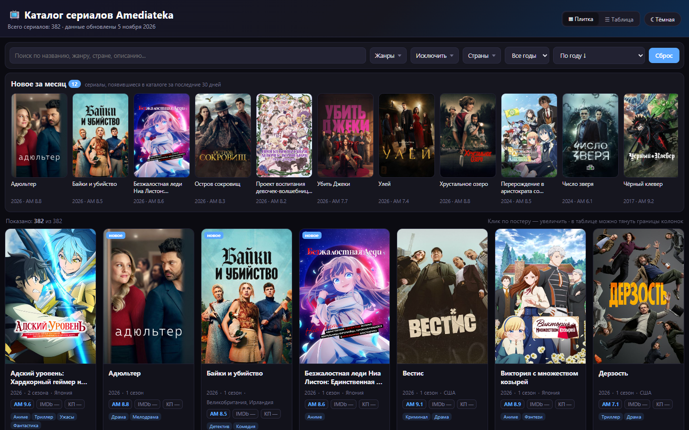

<p align="center">
  <a href="dist/amediateka_catalog.html"></a>
  <a href="https://nodejs.org"></a>
  <a href="LICENSE"></a>
</p>

<h1 align="center">Каталог сериалов Amediateka</h1>
<p align="center">Статический каталог с постерами, фильтрами и ежемесячным обновлением данных</p>

---

Каталог сериалов Amediateka в виде одного HTML-файла: постеры, жанры, страны, годы, сезоны и рейтинги Amediateka, IMDb и Кинопоиска. Данные снимаются с публичного API Amediateka. Автообновление — локальная задача Windows Task Scheduler: ежедневная проверка, фактическое обновление один раз в месяц.

- **Два варианта** — статический HTML со строками и версия со встроенным JSON.
- **Новое за месяц** — лента новинок и бейджи на постерах; новинка определяется по дате первого появления в снимке (30 дней).
- **Фильтры** — поиск, жанры, исключение жанров, страны, год.
- **Сортировка** — по году, названию, жанру, сезонам и рейтингам; если IMDb/КП нет, используется рейтинг Amediateka.
- **Постеры** — пропорции 2:3, ленивая загрузка, скелетоны, заглушки при ошибке, лайтбокс.
- **Оформление** — тёмная и светлая тема, плитка и таблица, адаптив.

## Быстрый старт

```bash
git clone https://github.com/AlexanderKuzikov/Amediateka-Catalog.git
cd Amediateka-Catalog
npm run monthly
```

Открыть `dist/amediateka_catalog.html` или `dist/amediateka_catalog_json.html`. Зависимостей нет, `npm install` не нужен.

Для автообновления раз в месяц зарегистрировать задачу:

```powershell
powershell -ExecutionPolicy Bypass -File scripts/install-task.ps1
```

## Скриншоты

<p align="center">
  
</p>

## Документация

- [`docs/CONTEXT.md`](docs/CONTEXT.md) — состояние проекта и журнал
- [`docs/DECISIONS.md`](docs/DECISIONS.md) — архитектурные решения

## Стек

| Компонент | Технология |
|-----------|------------|
| UI | HTML, CSS, vanilla JS |
| Сборка | Node.js 22, ESM, без зависимостей |
| Данные | JSON + публичный API Amediateka |
| Автоматизация | Windows Task Scheduler, локальный запуск |

## Статус

**v1.0.0** — 382 сериала, 24 страны, локальное автообновление раз в месяц.

## Лицензия

Код — [MIT](LICENSE) © Alexander Kuzikov. Данные и постеры принадлежат Amediateka и используются в информационных целях.
